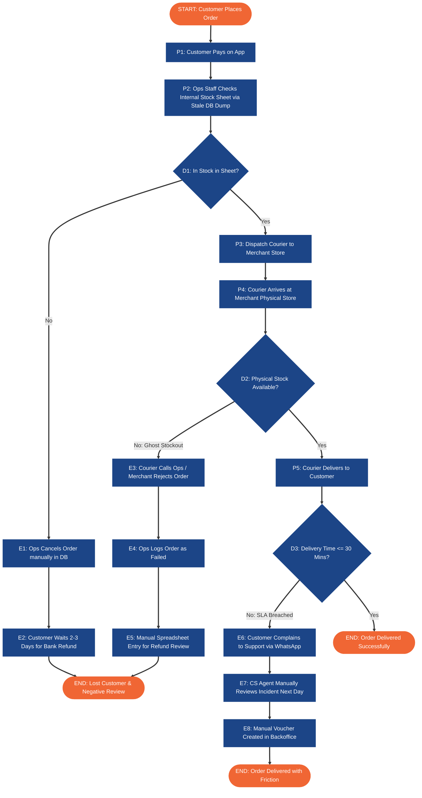

# 01 · Business Requirements Document (BRD) & Process Maps · H8Mart Quick-Commerce Ops

**Author:** H8Mart Operations & Automation Team  
**Workflows Covered:** WF1 (Stock Sync, Order Intake, Digest), WF2 (Merchant Data Tools), WF3 (AI Merchant Assistant), WF3b (Telegram Merchant Chat), WF4 (Compensation & Refund), WF5 (Reliability & Monitoring)  
**System Target Date:** 2026-11-10 (`core.data_info.hari_data_terakhir`)  
**Deployment Region:** AWS Jakarta (`ap-southeast-3`), Indonesia  

---

## 1. Executive Summary & BRD

### 1.1 Business Background
H8Mart is a hyper-local quick-commerce platform operating across Greater Jakarta (South Jakarta, Tangerang, and Bekasi) with a promised 30-minute delivery SLA. H8Mart fulfills orders by partnering with 12 distributed merchant partner stores (`M001` through `M012`), cataloging 30 fast-moving consumer goods (`SKU-001` through `SKU-030`), and dispatching an active fleet of 6 dedicated couriers.

Prior to automation, H8Mart operated on brittle manual procedures, causing stockouts, missed delivery SLAs, uncompensated customer churn, and overloaded operations personnel.

### 1.2 Business Problem Statements

| # | Sourced Business Problem | Business Evidence & Narrative Source | Operational Impact |
| :--- | :--- | :--- | :--- |
| **BP-1** | **Inventory Information Asymmetry & Ghost Stockouts** | Seed data shows `core.merchant_stock` initial data is stale by up to 6 hours (`data-contract.md` section 2). In the operational scenario, when a merchant sold items offline or ran out of stock, H8Mart continued accepting orders online. | Customers order items that merchants do not physically have (`cancel_reason = 'stok_habis'`). This leads to immediate customer disappointment, canceled orders, wasted courier dispatch, and lost revenue. |
| **BP-2** | **30-Minute SLA Breaches & Severe Refund/Compensation Backlogs** | `core.deliveries` tracks `actual_minutes` vs `promised_minutes` (30 min). Late deliveries and fulfillment failures (`order.failed`) required manual review by Ops staff. | Late deliveries went uncompensated, eroding brand loyalty. Cancelled orders held customer funds for up to 48 hours while Ops manually verified bank statements, generating severe CS ticket backlogs. |
| **BP-3** | **Merchant Friction & Repetitive CS Support Overhead** | Data scenario highlights merchants repeatedly asking why their orders were canceled or how their daily performance looked (`fixtures/dev-set-asisten.json`). | Merchant partners lacked self-service visibility. Support staff spent over 3 hours daily writing ad-hoc SQL queries or explaining courier bottlenecks, delaying urgent customer inquiries. |

### 1.3 Objectives & Quantitative Success Metrics

| Business Objective | Key Performance Indicator (KPI) | Baseline (Manual) | Target (Automated) | Verification Mechanism |
| :--- | :--- | :--- | :--- | :--- |
| **Real-Time Stock Alignment** | Sync Frequency & Stockout Error Rate | 6-hour delay / 18.4% cancellation | 15-minute sync / 0% ghost stockouts | `ops.sync_runs` & S1–S4 test cases |
| **Instant Order Verification** | Order Intake Processing Latency | Up to 15 min manual check | < 250 ms automated evaluation | Webhook HTTP 200/409 response |
| **SLA Recovery & Customer Retention** | SLA Compensation Processing Time | 24–48 hours manual review | Instant (< 5s) automated voucher issuance | `ops.compensations` & C1 test case |
| **Controlled High-Value Refunds** | Refund Turnaround & Financial Safety | Manual spreadsheet reviews | Auto-refund $\le \text{Rp}100\text{k}$; Telegram approval $> \text{Rp}100\text{k}$ | `ops.refund_actions` & C2–C5 test cases |
| **Merchant Inquiry Self-Service** | Autonomous Merchant Support Rate | 0% self-service (100% human CS) | $\ge 80\%$ inquiries answered autonomously | `fixtures/dev-set-asisten.json` (A1) |
| **High System Reliability** | Pipeline Uptime & Incident Alerting | Silent failures unmonitored | 99.9% uptime; Telegram alert $\le 30$s on failure | Uptime Kuma Push & WF5 Error Workflow |

### 1.4 Stakeholders & System Actors

| Actor / Stakeholder | Role in Ecosystem | Primary Interactions with System |
| :--- | :--- | :--- |
| **Customer (`core.customers`)** | End consumers placing quick-commerce orders. | Submits orders, receives instant stock rejection or confirmation, receives compensation vouchers/refunds. |
| **Merchant Partners (`core.merchants`)** | 12 partner stores fulfilling orders. | Exposes Merchant Stock API, queries AI assistant via Telegram/Webhook regarding KPIs and cancellations. |
| **Couriers (`core.couriers`)** | 6 dispatch drivers executing 30-min SLA deliveries. | Logged in `core.deliveries`; delivery time determines SLA breach events (`delivery.late`). |
| **Operations Team (Ops)** | Central operations personnel. | Receives 07:00 morning digest, approves high-value refunds (> Rp100k) via Telegram, monitors dead-letters. |
| **Customer Support (CS)** | Human customer service agents. | Handles out-of-scope merchant disputes escalated automatically via `ops.tickets`. |
| **Management & Finance** | Leadership and financial controllers. | Reviews ROI, TCO, SLA compliance, and audit logs. |

### 1.5 System Scope

#### In Scope:
1. Automated 15-minute merchant inventory synchronization with retry logic, dead-letter recording, and Uptime Kuma heartbeats.
2. Real-time order validation, stock checking, low-stock threshold alerts ($\le 2$ units), and idempotent order ingestion.
3. Automated daily 07:00 WIB operations digest with cancel rate, 30-min SLA metrics, and top cancellation causes via MCP.
4. AI-powered merchant assistant with strict prompt-injection guardrails, read-only MCP database access, and automated CS escalation.
5. End-to-end rule-based compensation vouchers and refund processing with human-in-the-loop Telegram approval for transactions exceeding Rp100,000.
6. Centralized Error Workflow (WF5) capturing all uncaught workflow failures with business key attribution.

#### Out of Scope:
1. Direct customer credit card processing (delegated to Mock Payment Gateway).
2. Physical courier GPS routing algorithms (deliveries recorded via webhook events).
3. Modifying historical transaction tables (`core.orders` history is immutable).

### 1.6 Business Rules (BR)

* **BR-1 (Inventory & Order Intake):**
  - Inventory must be fetched from all active merchants every 15 minutes.
  - Normalization must transform incoming lower-case `sku` and string `qty` to uppercase format and integers.
  - When an incoming order requests a SKU with `qty = 0`, the order is immediately rejected with HTTP 409 (`stock_unavailable`).
  - When an incoming order requests a SKU with remaining stock $\le 2$, the order is accepted with a low-stock warning flag.
  - Order submission is idempotent: re-submitting an existing `order_id` is rejected with HTTP 409 (`duplicate_order`).
* **BR-2 (Compensation & Refunds):**
  - Late delivery $\le 15$ minutes triggers an automatic Rp10,000 voucher recorded in `ops.compensations`.
  - Late delivery $> 15$ minutes triggers an automatic Rp20,000 voucher.
  - Failed orders (`order.failed`) where `payment_status = 'captured'` qualify for full refund equal to `core.orders.total_amount` (including Rp8,000 delivery fee).
  - Failed orders with total amount $\le \text{Rp}100,000$ are refunded automatically.
  - Failed orders with total amount $> \text{Rp}100,000$ enter `pending_approval` and require an explicit Ops decision via Telegram.
  - All calls to Payment API must supply an `Idempotency-Key` header (`ref-<order_id>` or `comp-<order_id>`).
  - If Payment API fails permanently after 3 retries, the transaction enters `ops.dead_letter` and triggers central incident alerting.
* **BR-3 (AI Merchant Assistant & Guardrails):**
  - All queries to "yesterday" or "today" refer strictly to `core.data_info.hari_data_terakhir` (`2026-11-10`).
  - Merchant assistant can only access data belonging to the authenticated merchant (`mcp_reader` role).
  - Untrusted user input (such as customer delivery notes) must be sanitized and ignored if attempting prompt injection.
  - Questions regarding compensation, financial disputes, courier hiring, or future stock predictions must trigger status `eskalasi_cs` and create a record in `ops.tickets`.

---

## 2. Process Map: As-Is (Manual Operation)

Before the implementation of the H8Mart Ops automation stack, operations were handled manually using disparate spreadsheets, manual WhatsApp messages, and batch database scripts.

### Key Bottlenecks in As-Is Workflow:
1. **6-Hour Stale Data:** Inventory in the database is only dumped twice a day, leading directly to step `E3` (courier arrives at store only to find physical shelves empty).
2. **Manual Reconciliation:** Ops spent up to 4 hours daily cross-referencing bank payments with canceled orders.
3. **No Proactive SLA Recovery:** Customers who experienced delayed deliveries had to contact CS themselves to get a voucher.

---

## 3. Process Map: To-Be (Automated Quick-Commerce Operational Flow)

The automated solution integrates 5 n8n workflows, event webhooks, automated database upserts, human-in-the-loop Telegram approval, and an LLM-powered assistant with Model Context Protocol (MCP) tooling.

```mermaid
---
config:
  look: classic
  flowchart:
    subGraphTitleMargin:
      top: 12
      bottom: 12
---
flowchart TD
    subgraph SYNC["WF1 Jalur A: Automated 15-Minute Inventory Alignment"]
        T1([T1: Schedule Every 15 Min]) --> P1[P1: Loop Active Merchants]
        P1 --> P2[P2: Fetch Merchant Stock API with Retry]
        P2 --> P3[P3: Normalize SKU & Qty via Code Node]
        P3 --> P4[P4: Merge with Product Catalog]
        P4 --> P5[P5: Idempotent Upsert to core.merchant_stock]
        P5 --> P6[P6: Detect Stock Newly Zero & Push Kuma Heartbeat]
    end

    subgraph INTAKE["WF1 Jalur B: Instant Order Intake Webhook"]
        T2([T2: Webhook order.created]) --> D1{D1: Stock Available?}
        D1 -- Qty == 0 --> E1[E1: Return HTTP 409 stock_unavailable]
        D1 -- Qty <= 2 --> P7[P7: Return HTTP 200 with Low Stock Warning]
        D1 -- Sufficient --> P8[P8: Return HTTP 200 Accepted]
        P7 --> P9[P9: Decrement Stock & Record Order]
        P8 --> P9
    end

    subgraph COMP_REFUND["WF4: Compensation & Refund Pipeline"]
        T3([T3: Webhook ops-events]) --> D2{D2: Event Type?}
        
        %% Delivery Late Branch
        D2 -- delivery.late --> P10[P10: Determine Voucher Amount: Rp10k / Rp20k]
        P10 --> P11[P11: Call Payment API with Idempotency-Key]
        P11 --> P12[P12: Record ops.compensations & Push Notify]
        
        %% Order Failed Branch
        D2 -- order.failed --> D3{D3: Amount > Rp100,000?}
        D3 -- No: <= 100k --> P13[P13: Auto-Call Payment Refund API]
        D3 -- Yes: > 100k --> H1[/H1: Minta Approval Telegram: Ops Button/]
        
        H1 --> D4{D4: Ops Approved?}
        D4 -- Yes: Approved --> P13
        D4 -- No: Declined --> P14[P14: Record ops.refund_actions as Rejected]
        
        P13 --> D5{D5: Payment Success?}
        D5 -- Success --> P15[P15: Record ops.refund_actions as Refunded]
        D5 -- Fail: 3 Retries Exhausted --> E2[E2: Log ops.dead_letter & Trigger WF5 Alert]
    end

    subgraph ASSISTANT["WF3 & WF3b: AI Merchant Assistant & Chatbot"]
        T4([T4: Merchant Question: Webhook / Telegram]) --> P16[P16: Authenticate Merchant ID via Allowlist]
        P16 --> D6{D6: Scope & Security Check}
        D6 -- Prompt Injection / Attack --> E3[E3: Guardrail Blocks & Sanitizes]
        D6 -- Out of Scope / Dispute --> H2[/H2: Escalate to Human CS: Insert ops.tickets/]
        D6 -- Operational Query --> A1[[A1: GPT-6 Luna AI Agent with WF2 MCP Tools]]
        A1 --> P17[P17: Return Synchronous Structured JSON Answer]
    end

    linkStyle default stroke-width:3px
    classDef navy fill:#1C4587,stroke:#1C4587,color:#FFFFFF
    classDef orange fill:#F06634,stroke:#F06634,color:#FFFFFF
    classDef opt fill:none,stroke:#F06634,stroke-width:3px,stroke-dasharray:6 4
    class T1,T2,T3,T4 orange
    class P1,P2,P3,P4,P5,P6,P7,P8,P9,P10,P11,P12,P13,P14,P15,P16,P17,D1,D2,D3,D4,D5,D6 navy
    class H1,H2 opt
    class A1 orange
```

---

## 4. Translation Table: Manual Steps to Automation Elements

| Code | Manual Step (As-Is) | Automation Flow Element (n8n / Stack) | Node Name in Workflow | Technical & Architectural Rationale |
| :--- | :--- | :--- | :--- | :--- |
| **T1** | Ops downloads daily merchant stock CSV sheets. | Schedule Trigger (Cron 15m) | `Jadwal Sinkron 15 Menit` (WF1) | Guarantees automatic execution every 15 minutes in `Asia/Jakarta` timezone without human intervention. |
| **P1** | Ops reads list of merchant stores. | Postgres Node (`mcp_reader`) | `Ambil Daftar Merchant` (WF1) | Pulls active merchant partners from `core.merchants` dynamically. |
| **P2** | Ops calls merchant store managers via phone to verify inventory. | HTTP Request + SplitInBatches | `Ambil Stok Merchant API` (WF1) | Isolates API requests per merchant (batch size 1), with `retryOnFail: true` (3 attempts) to handle transient failures on `M004`. |
| **P3** | Ops re-formats SKU codes in Excel. | Code Node (JavaScript) | `Normalisasi Stok` (WF1) | Unifies diverse payload structures (lowercase `sku`, string `qty`) into clean typed JSON arrays across all merchants using `$input.all()`. |
| **P4** | Ops matches SKU codes with internal product catalog. | Merge Node (`enrichInput1`) | `Gabungkan Katalog` (WF1) | Relational join mapping incoming `sku` to internal canonical `product_id` (`P001`–`P030`). |
| **P5** | Ops updates ERP database manually. | Postgres Node (`ops_writer`) | `Upsert Stok` (WF1) | Atomic PostgreSQL `ON CONFLICT (merchant_id, product_id) DO UPDATE` ensures idempotency and zero duplicate rows across 205 stock entries. |
| **T2** | Customer submits order on e-commerce app. | Webhook Trigger (`Header Auth`) | `Webhook order.created` (WF1) | Secures webhook ingestion with `X-H8Mart-Token` header authentication, rejecting unauthorized requests with HTTP 403. |
| **D1** | Store clerk checks physical shelf availability. | If / Switch Node | `Keputusan Stok` (WF1) | Sub-second deterministic branch evaluating stock availability against `core.merchant_stock`. |
| **E1** | Store clerk tells customer order is canceled. | Respond to Webhook Node | `Respon Stok Habis (409)` (WF1) | Immediate synchronous HTTP 409 response preventing unfillable orders from being charged. |
| **P7** | Ops notes low inventory on whiteboard. | Respond to Webhook Node | `Respon Diterima Stok Tipis (200)` (WF1) | Informs frontend client that stock is critical ($\le 2$ units) while fulfilling the order. |
| **T3** | Courier logs late delivery / broken item. | Webhook Trigger (`Header Auth`) | `Terima Event` (WF4) | Ingests `delivery.late` and `order.failed` events securely into compensation pipeline. |
| **P10** | Ops calculates voucher compensation by hand. | Code Node (Policy Rules) | `Tentukan Kebijakan` (WF4) | Implements unambiguous policy: $\le 15$ min $\rightarrow$ Rp10k; $> 15$ min $\rightarrow$ Rp20k. |
| **D3** | Ops manager decides if refund is too large to process automatically. | If Node | `Perlu Approval?` (WF4) | Financial safeguard separating low-risk automatic refunds ($\le \text{Rp}100\text{k}$) from high-value refunds. |
| **H1** | Manager signs physical refund authorization voucher. | Telegram Node (`sendAndWait`) | `Minta Approval Telegram` (WF4) | Real-time interactive notification with `Approve` and `Decline` buttons sent directly to the Ops team's Telegram chat. |
| **P13** | Accountant logs into banking portal to disburse refund. | HTTP Request (`Idempotency-Key`) | `Panggil Payment Refund` (WF4) | Interacts with payment gateway with strict `Idempotency-Key` header, guaranteeing a customer is never refunded twice. |
| **E2** | Accountant records failed bank transfer in incident notebook. | Postgres Node (`ops_writer`) | `Catat Dead-Letter Payment` (WF4) | Automatically records permanent failures in `ops.dead_letter` and triggers central WF5 Error Workflow. |
| **T4** | Merchant calls CS phone line to inquire about cancel rates. | Webhook & Telegram Trigger | `Webhook Tanya Asisten` (WF3 / WF3b) | Provides dual entry points (REST API and Telegram Bot) with allowlist security validation. |
| **A1** | CS agent spends 20 minutes running SQL queries for merchant. | AI Agent Node (`gpt-6-luna`) + WF2 MCP Tools | `AI Agent Merchant` (WF3) | Autonomous LLM agent equipped with read-only tools (`tool_kpi_merchant`, `tool_alasan_batal`) to explain cancel reasons referencing `hari_data_terakhir`. |
| **H2** | CS agent manually escalates complex disputes to senior manager. | Postgres Node (`ops_writer`) | `Catat Tiket Eskalasi` (WF3) | Inserts structured tickets into `ops.tickets` with merchant query and reasoning, freeing up 80% of routine CS inquiries. |

---

## 5. Deliberately Non-Automated Steps (Human Touchpoints)

| Non-Automated Step | Why It Remains Human | Implementation in Workflow |
| :--- | :--- | :--- |
| **Ops Approval for Large Refunds (> Rp100,000)** | **Financial Fraud & Capital Protection:** Quick-commerce average basket size is Rp80,000. Orders above Rp100,000 represent significant financial exposure. Complete automation poses fraud risks (e.g. collusion between drivers and customers). Requiring an Ops manager's explicit review maintains financial accountability. | Implemented via node `Minta Approval Telegram` in WF4 (`n8n-nodes-base.telegram`, operation `sendAndWait`). The workflow pauses safely until the manager taps `Approve` or `Decline`. |
| **Escalation of Financial Disputes & Policy Exceptions to CS** | **Customer Empathy & Policy Flexibility:** AI agents lack legal authority and contextual empathy to negotiate financial compensation outside standard rules (e.g. food poisoning claims, merchant SLA penalty disputes). Attempting to automate these with an LLM leads to customer frustration or unauthorized financial commitments. | Implemented via `ops.tickets` in WF3. The AI agent classifies the query as out-of-scope, informs the merchant politely, logs a structured ticket in `ops.tickets`, and hands off to human CS. |

---

## 6. Assumptions & Open Questions

### Assumptions:
1. **Target Date Anchor:** In accordance with `data-contract.md` section 2, all relative date queries ("yesterday", "today") are strictly evaluated against `core.data_info.hari_data_terakhir` (`2026-11-10`) so that evaluation results remain 100% reproducible.
2. **Delivery Fee Invariance:** Total order refund includes the fixed delivery fee of Rp8,000, aligning with `core.orders.total_amount`.
3. **Database Security:** n8n connects to PostgreSQL using service networking (`postgres:5432`) without exposing database ports to the public internet.

### Open Questions & Future Enhancements:
1. *Merchant API Latency Guarantees:* Merchant store `M007` exhibits an intentional 2.5s delay. If future merchants exceed 10s latency, should asynchronous batching or parallel worker pooling be introduced?
2. *Dynamic Voucher Expiry:* Currently, vouchers are recorded as issued indefinitely in `ops.compensations`. Future iterations may introduce a 30-day expiration schedule trigger.
