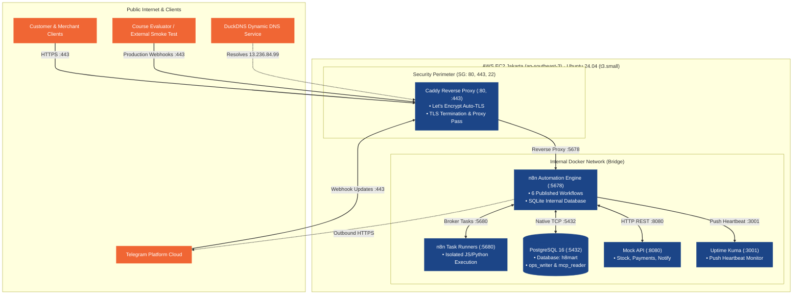

# 03 · 12-Month Total Cost of Ownership (TCO) & Deployment Architecture · H8Mart Quick-Commerce Ops

**Author:** H8Mart Operations & Cloud Architecture Team  
**Evaluation Target Date:** November 2026  
**Reference Exchange Rates:** 1 USD = Rp 16,000 | 1 EUR = Rp 17,200 (Pricing verified November 2026 from official cloud pricing portals)  

---

## 1. 12-Month TCO Comparison across 3 Architectural Options

To determine the most viable, secure, and cost-effective deployment strategy for H8Mart Quick-Commerce Operations, three architectural options were evaluated over a 12-month lifecycle:
1. **Option 1: Managed SaaS (n8n Cloud Pro Plan)**
2. **Option 2: Self-Hosted Cloud VPS (AWS EC2 Jakarta Region `ap-southeast-3`)**
3. **Option 3: On-Premise Dedicated Hardware (H8Mart Central Operations Hub, Jakarta)**

### 1.1 TCO Summary Comparison Table

| Cost Component | Option 1: n8n Cloud (SaaS Pro) | Option 2: Self-Hosted VPS (AWS Jakarta) | Option 3: On-Premise Server (HQ Jakarta) |
| :--- | :--- | :--- | :--- |
| **Initial Setup / CAPEX** | **Rp 0** (No hardware purchase) | **Rp 0** (Pure on-demand cloud infrastructure) | **Rp 24,000,000** (Server hardware, UPS backup, networking switch) |
| **Compute & Host Cost** | €50 / month $\approx$ **Rp 860,000 / mo** (n8n Cloud Pro base tier) | US\$19.27 / mo $\approx$ **Rp 308,320 / mo** (`t3.small` 2 vCPU, 2 GiB RAM, Jakarta) | **Rp 450,000 / mo** (Electricity 150W 24/7 + static IP business broadband) |
| **Storage & Data Volumes** | Included in SaaS tier (limited history) | US\$1.92 / mo $\approx$ **Rp 30,720 / mo** (20 GiB EBS `gp3`, 3,000 IOPS) | Included in server hardware purchase |
| **Public IPv4 & Networking** | Included | US\$3.65 / mo $\approx$ **Rp 58,400 / mo** (AWS public IPv4 rate: \$0.005/hr) | Static IP add-on: **Rp 200,000 / mo** |
| **Domain & SSL Certificates** | Included (n8n.cloud subdomain) | **Rp 0** (DuckDNS free dynamic DNS + Let's Encrypt Caddy auto-TLS) | **Rp 250,000 / year** (Custom domain) $\approx$ **Rp 20,800 / mo** |
| **Maintenance & Admin Labor** | 2 hrs / mo $\times$ Rp 50,000 = **Rp 100,000 / mo** (Workflow management) | 4 hrs / mo $\times$ Rp 50,000 = **Rp 200,000 / mo** (OS patch, Docker updates, backup) | 12 hrs / mo $\times$ Rp 50,000 = **Rp 600,000 / mo** (Physical hardware, UPS, cooling, OS) |
| **Execution Overage Risk** | **High:** Cap of 10,000 executions/mo; 15m sync alone consumes 2,880 runs/mo. Overages cost €20 / 5k runs. | **Zero:** Unlimited executions on self-hosted Docker container. | **Zero:** Unlimited executions. |
| **Monthly Operating Cost (OPEX)** | **Rp 960,000 / month** (Base, excluding execution overages) | **Rp 597,440 / month** (All-inclusive infra + admin labor) | **Rp 1,270,800 / month** (Broadband, power, labor) |
| **TOTAL 12-MONTH TCO** | **Rp 11,520,000** | **Rp 7,169,280** | **Rp 39,249,600** |

### 1.2 Pricing Formulas & Official Sources (Verified November 2026)
1. **AWS EC2 Jakarta (`ap-southeast-3`):**
   - Source: [AWS EC2 On-Demand Pricing - Jakarta Region](https://aws.amazon.com/ec2/pricing/on-demand/)
   - Instance `t3.small` (Linux, x86_64, 2 vCPUs, 2.0 GiB RAM): $\text{US\$ } 0.0264 \text{ / hour} \times 730 \text{ hours} = \text{US\$ } 19.272 \text{ / month}$.
   - Public IPv4 Address: $\text{US\$ } 0.005 \text{ / hour} \times 730 \text{ hours} = \text{US\$ } 3.65 \text{ / month}$.
   - EBS `gp3` Storage: $20 \text{ GiB} \times \text{US\$ } 0.096 \text{ / GiB-month} = \text{US\$ } 1.92 \text{ / month}$.
   - Monthly Infrastructure Subtotal: $\text{US\$ } 24.842 \times \text{Rp } 16,000 = \text{Rp } 397,472 \text{ / month}$.
2. **n8n Cloud SaaS:**
   - Source: [n8n Official Cloud Pricing](https://n8n.io/pricing/)
   - Pro Plan: €50 / month billed annually (capped at 10,000 workflow executions/month).
   - Exchange Rate: €50 $\times$ Rp 17,200 = Rp 860,000 / month.
3. **On-Premise Hardware:**
   - Microserver: Minisforum / Dell PowerEdge Entry Server (Intel i5/Xeon, 16GB RAM, 512GB SSD): Rp 18,000,000.
   - APC Smart-UPS 1000VA (Essential for Jakarta power grid outages): Rp 4,500,000.
   - Managed Gigabit Switch & Router: Rp 1,500,000.

---

## 2. Decision & Justification

### Selected Option: **Option 2: Self-Hosted Cloud VPS on AWS Jakarta (`ap-southeast-3`)**

### 2.1 Technical & Operational Justifications
1. **Direct Container Networking & MCP Protocol Streaming:**
   The H8Mart operational stack requires high-throughput, low-latency inter-service communication between n8n, PostgreSQL, Mock API, and the Model Context Protocol (MCP) server. Running all components on Docker Compose within a single VPS enables local service mesh resolution (`postgres:5432`, `mock-api:8080`, `n8n:5678`). External cloud SaaS would require exposing the internal PostgreSQL and mock APIs to the public internet, dramatically increasing attack surface and latency.
2. **Predictable Pricing without Execution Caps:**
   H8Mart's 15-minute stock synchronization runs 96 times daily (2,880 runs/month). Ingesting 6,000 orders and hundreds of compensation webhooks would breach n8n Cloud's 10,000 execution cap, resulting in steep penalty charges. The self-hosted VPS handles unlimited executions with zero marginal cost per run.
3. **Cost Efficiency:**
   At **Rp 7,169,280** for 12 months, the self-hosted AWS solution is **38% less expensive than n8n Cloud** and **82% cheaper than on-premise hardware**, requiring zero upfront capital expenditure.

### 2.2 Indonesian Legal Compliance: UU No. 27 Tahun 2022 (UU PDP) Analysis

Operating an e-commerce platform handling Indonesian consumers requires strict adherence to **Undang-Undang Republik Indonesia Nomor 27 Tahun 2022 tentang Perlindungan Data Pribadi (UU PDP)**:

1. **In-Country Data Residency & Sovereignty (Article 20 & Article 56):**
   - *Requirement:* Personal data controllers must process personal data within Indonesian territory unless cross-border transfers meet explicit adequacy requirements or bilateral treaties.
   - *H8Mart Solution:* Deploying in the **AWS Jakarta Region (`ap-southeast-3`)** guarantees that all customer names, phone numbers, delivery addresses, and transactional records in `core.customers` and `core.orders` reside entirely on Indonesian soil. n8n Cloud hosts data in Frankfurt (Germany) or US regions, creating serious regulatory exposure under UU PDP.
2. **Technical & Organizational Security Measures (Article 35):**
   - *Requirement:* Data controllers must implement encryption, access control, and confidentiality safeguards to prevent personal data leaks.
   - *H8Mart Solution:*
     - All public endpoints are protected with automated TLS 1.3 encryption via Caddy and Let's Encrypt.
     - Database ports (`5432`/`5440`), Mock API (`8080`), and Uptime Kuma (`3011`) bind strictly to `127.0.0.1` and internal Docker networks, completely blocked from internet ingress.
     - Strict database credential separation: AI assistant operations use read-only role `mcp_reader`, preventing unauthorized data mutation or injection leaks.
3. **Audit Trails & Purpose Limitation (Article 36 & Article 37):**
   - *Requirement:* Data processing must maintain immutable logs and audit trails detailing access and processing history.
   - *H8Mart Solution:* Every automated refund, compensation voucher, and error is recorded with execution timestamps in `ops.refund_actions`, `ops.compensations`, and `ops.dead_letter`.

---

## 3. Final Production Deployment Plan

### 3.1 Deployment Architecture Diagram

### 3.2 Technical Specification Matrix

| Component | Technical Specification | Configuration & Operational Detail |
| :--- | :--- | :--- |
| **Cloud Provider & Region** | Amazon Web Services (AWS) | Region: **Asia Pacific (Jakarta) `ap-southeast-3`** |
| **Instance Type & Specs** | `t3.small` (2 vCPU, 2.0 GiB RAM) | 2 GiB Swapfile added (`/swapfile`), 20 GiB `gp3` SSD storage |
| **Operating System** | Ubuntu Server 24.04 LTS (x86_64) | Docker Engine v27.x + Docker Compose v2.24+ |
| **Container Stack (`compose.yaml` + `compose.vps.yaml`)** | 6 Services Running | 1. `n8n` (v2.44.7, automation engine) 2. `task-runners` (v2.44.7, isolated code execution) 3. `postgres` (v16.15-alpine, H8Mart relational database) 4. `mock-api` (vnode:24-alpine, stock, payment, notification APIs) 5. `uptime-kuma` (v2.5.8, heartbeat push monitor) 6. `caddy` (reverse proxy with automated Let's Encrypt HTTPS) |
| **Networking & Security Group** | AWS Security Group | • Ingress: Port 80, 443 (Worldwide `0.0.0.0/0`), Port 22 (SSH from My IP only) • Ports 5690, 5440, 8080, 3011 are **not exposed** to internet (bound to localhost / Docker network) |
| **Database for n8n State** | Embedded SQLite | Stored in persistent Docker named volume `n8n_data`. Pruned every 14 days (336 hours) to prevent disk growth. |
| **Domain & TLS Setup** | DuckDNS + Caddy | Subdomain: `https://h8mart-ekorianto.duckdns.org`. Caddy automatically provisions and renews Let's Encrypt TLS certificates. |
| **Evaluator Production Webhooks** | Public HTTPS Endpoints | • WF1 Order Intake: `https://h8mart-ekorianto.duckdns.org/webhook/order-created` • WF3 AI Merchant: `https://h8mart-ekorianto.duckdns.org/webhook/merchant-assistant` • WF4 Events: `https://h8mart-ekorianto.duckdns.org/webhook/ops-events` • Header Authentication: `X-H8Mart-Token: h8mart-webhook-lab` |
| **Backup & Disaster Recovery** | Automated Volume Snapshots | Nightly `pg_dump` of `h8mart` PostgreSQL database and tarball of `n8n_data` SQLite volume to external S3 / EBS snapshot. Restoration verified via `docker compose down -v && docker compose up -d`. |

---

## 4. Verification Evidence Matrix

All verification assets are archived in the repository under `evidence/deploy/`:

| Verification Item | Evidence File Path | Verification Description |
| :--- | :--- | :--- |
| **Valid HTTPS in Browser** | [`01-https.png`](file:///c:/Users/Windows/Documents/antigravity/milestone_phase3_set1/h8mart-ops/evidence/deploy/01-https.png) | Browser screenshot showing valid Let's Encrypt SSL certificate and secure padlock on domain `https://h8mart-ekorianto.duckdns.org`. |
| **Container Health & Status** | [`02-compose-ps.png`](file:///c:/Users/Windows/Documents/antigravity/milestone_phase3_set1/h8mart-ops/evidence/deploy/02-compose-ps.png) & [`01-compose-ps.txt`](file:///c:/Users/Windows/Documents/antigravity/milestone_phase3_set1/h8mart-ops/evidence/deploy/01-compose-ps.txt) | Confirms all 6 Docker services are running and healthy (`caddy`, `n8n`, `postgres`, `mock-api`, `task-runners`, `uptime-kuma`). |
| **All Workflows Published** | [`All Workflow Published.png`](file:///c:/Users/Windows/Documents/antigravity/milestone_phase3_set1/h8mart-ops/evidence/deploy/All%20Workflow%20Published.png) | Complete n8n overview showing all workflows (WF1–WF5, WF3b) with active Published status. |
| **External Smoke Test** | [`02-curl-smoke-test.txt`](file:///c:/Users/Windows/Documents/antigravity/milestone_phase3_set1/h8mart-ops/evidence/deploy/02-curl-smoke-test.txt) | Proof of external `curl` calls hitting the production HTTPS webhook from outside the VPS network. |
| **Schema & Environment Audit** | [`03-schema-and-env-audit.txt`](file:///c:/Users/Windows/Documents/antigravity/milestone_phase3_set1/h8mart-ops/evidence/deploy/03-schema-and-env-audit.txt) | Audit confirming `.env` is uncommitted, zero secret leakage, and PostgreSQL roles enforce read-only segregation. |
