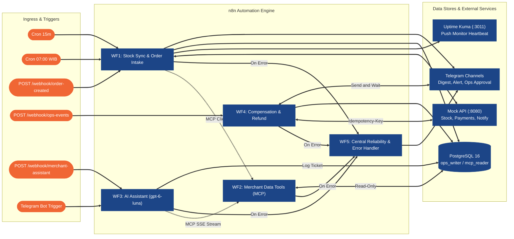
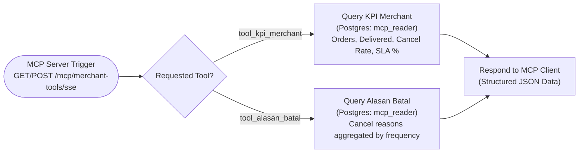
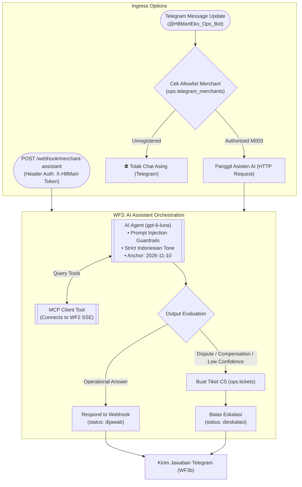
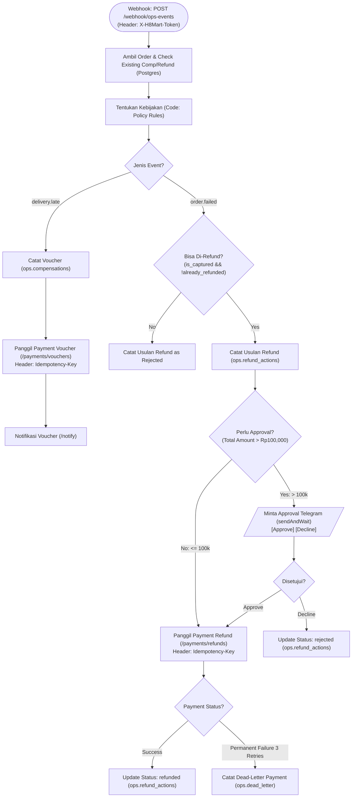
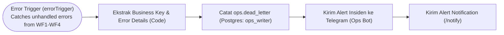

# H8Mart Quick-Commerce Ops · Solution Guide & Verification Manual

**Author:** H8Mart Operations & Automation Team  
**Evaluation Target Date:** November 2026  
**Reference Anchor Date:** `2026-11-10` (`core.data_info.hari_data_terakhir`)  
**Deployment Infrastructure:** AWS EC2 Jakarta Region (`ap-southeast-3`), Docker Compose, Caddy HTTPS, DuckDNS  

---

## 1. Executive Summary

H8Mart Quick-Commerce Ops is an automated, event-driven operational stack built on n8n, PostgreSQL, and Model Context Protocol (MCP) to solve inventory asymmetry, strict 30-minute delivery SLA breaches, and merchant support overhead across 12 partner stores in Greater Jakarta. 

The system unifies real-time 15-minute stock synchronization with transient retry logic, sub-second order intake stock validation, automated SLA compensation vouchers, and human-in-the-loop Telegram approval for refunds exceeding Rp100,000. 

An autonomous AI merchant assistant powered by `gpt-6-luna` queries read-only MCP database tools to explain cancellation causes, hardened with prompt-injection defenses and automated CS escalation, backed by centralized dead-letter monitoring and Uptime Kuma push heartbeats.

---

## 2. Solution Architecture



---

## 3. Workflow Directory & Functional Specifications

| Workflow Name | Export File | Trigger Type | Single-Sentence Functional Role |
| :--- | :--- | :--- | :--- |
| **WF1 Stock Sync, Order Intake & Digest** | `workflows/wf1-stock-sync-order-intake.json` | Schedule (15m, 07:00) & Webhook (`order.created`) | Synchronizes inventory with retry/dead-letter, validates sub-second order stock availability, and broadcasts daily morning KPI digests. |
| **WF2 Merchant Data Tools** | `workflows/wf2-merchant-data-tools.json` | MCP Server Trigger (`/mcp/merchant-tools/sse`) | Serves read-only analytical tools (`tool_kpi_merchant`, `tool_alasan_batal`) over Model Context Protocol SSE transport. |
| **WF3 Asisten AI Merchant** | `workflows/wf3-ai-merchant-assistant.json` | Webhook (`merchant-assistant`) | Synthesizes cancellation reasons and merchant performance via `gpt-6-luna`, with strict prompt injection guardrails and CS escalation. |
| **WF3b Chat Asisten Telegram** | `workflows/wf3b-chat-telegram.json` | Telegram Trigger | Exposes the AI assistant conversational interface to merchants via Telegram with strict `ops.telegram_merchants` allowlist authorization. |
| **WF4 Kompensasi & Refund** | `workflows/wf4-compensation-refund.json` | Webhook (`ops-events`) | Automatically processes late delivery vouchers, executes idempotent refunds, and requests interactive Ops Telegram approval for orders $> \text{Rp}100\text{k}$. |
| **WF5 Reliability & Monitoring** | `workflows/wf5-reliability-monitoring.json` | Error Trigger (`errorTrigger`) | Acts as central error handler across all workflows, attributing business keys, alerting Ops on Telegram, and tracking Uptime Kuma push status. |

---

### 3.1 Detailed Workflow Flowcharts

#### WF1: Stock Sync, Order Intake & Morning Digest Flow

```mermaid
---
config:
  look: classic
---
flowchart TD
    subgraph WF1_A["Jalur A: 15-Minute Inventory Sync"]
        T_SYNC(["Schedule: Every 15 Min / Webhook: trigger-stock-sync"]) --> N_GET_M["Ambil Daftar Merchant (core.merchants)"]
        N_GET_M --> N_LOOP["Loop Per Merchant (SplitInBatches: 1)"]
        N_LOOP --> N_API["Ambil Stok Merchant API (GET /merchants/:id/stock)"]
        N_API --> N_NORM["Normalisasi Stok (Code: SKU uppercase & Integer qty)"]
        N_NORM --> N_JOIN["Gabungkan Katalog (Merge with core.products)"]
        N_JOIN --> N_UPSERT["Upsert Stok (ON CONFLICT DO UPDATE)"]
        N_UPSERT --> N_CHK_SLOW{"Terlalu Lambat?<br/>(> 5000ms)"}
        N_CHK_SLOW -->|Yes| N_SLOW_ALERT["Alert Perlambatan (Telegram)"]
        N_CHK_SLOW -->|No| N_KUMA["Heartbeat Uptime Kuma (Push Monitor)"]
        N_SLOW_ALERT --> N_KUMA
        N_KUMA --> N_CHK_ZERO{"Ada Produk Habis Baru?"}
        N_CHK_ZERO -->|Yes| N_ZERO_NOTIF["Laporkan Produk Habis (/notify)"]
        N_CHK_ZERO -->|No| N_RUN_LOG["Catat Sync Run (ops.sync_runs)"]
        N_ZERO_NOTIF --> N_RUN_LOG
    end

    subgraph WF1_B["Jalur B: Real-Time Order Intake Webhook"]
        T_ORD(["Webhook: POST /webhook/order-created"]) --> N_CHK_STOCK["Ambil Stok Produk (core.merchant_stock)"]
        N_CHK_STOCK --> N_DECIDE{"Keputusan Stok"}
        N_DECIDE -->|Qty == 0| R_409["Respon 409: stock_unavailable"]
        N_DECIDE -->|Qty <= 2| R_200_WARN["Respon 200: Low Stock Warning"]
        N_DECIDE -->|Sufficient| R_200_OK["Respon 200: Order Accepted"]
        R_200_WARN --> N_DEC_STOCK["Kurangi Stok Produk & Catat Order"]
        R_200_OK --> N_DEC_STOCK
    end

    subgraph WF1_C["Jalur C: Daily 07:00 Morning Digest"]
        T_DIG(["Schedule: 07:00 WIB / Webhook: trigger-digest"]) --> N_KPI["Hitung KPI Harian (core.orders & deliveries)"]
        N_KPI --> N_DIG_CHK{"Digest Kosong?"}
        N_DIG_CHK -->|Yes: 0 Rows| N_FAIL_DIG["Gagal: Digest Kosong"]
        N_DIG_CHK -->|Valid| N_MCP_REASON["Alasan Batal Teratas (MCP Client Tool)"]
        N_MCP_REASON --> N_FMT_DIG["Tambah Alasan ke Digest (Code)"]
        N_FMT_DIG --> N_TG_DIG["Kirim Digest Telegram (Bot Ops)"]
        N_TG_DIG --> N_NOTIF_DIG["Kirim Digest Notification (Mock API /notify)"]
    end
```


#### WF2: Merchant Data Tools (MCP Server) Flow


#### WF3 & WF3b: AI Merchant Assistant & Telegram Bot Flow


#### WF4: Compensation & Refund Pipeline Flow


#### WF5: Central Reliability & Monitoring Flow


---

## 4. Setup & Deployment Instructions

### 4.1 Prerequisites
* Docker Engine v24.0+ and Docker Compose v2.24+.
* Git installed.
* Available host ports (or configurable via `.env`): `5690` (n8n), `3011` (Uptime Kuma), `5440` (PostgreSQL), `8080` (Mock API).

### 4.2 Local Stack Setup (Windows PowerShell 7)
```powershell
# 1. Clone repository and navigate to folder
git clone <your-repo-url> h8mart-ops
Set-Location h8mart-ops

# 2. Initialize environment file from example template
Copy-Item .env.example .env

# 3. Start complete local operational stack
docker compose up -d

# 4. Verify all containers are running and PostgreSQL is healthy
docker compose ps

# 5. Verify database seed initialization (Expected: 12 merchants, 30 products, 205 stock rows)
docker compose exec -T postgres psql -U h8mart -d h8mart -At -c "SELECT (SELECT count(*) FROM core.merchants), (SELECT count(*) FROM core.products), (SELECT count(*) FROM core.merchant_stock);"
```

### 4.3 Local Stack Setup (macOS / Linux / Bash)
```bash
# 1. Clone repository and navigate to folder
git clone <your-repo-url> h8mart-ops
cd h8mart-ops

# 2. Initialize environment file
cp .env.example .env

# 3. Start local stack
docker compose up -d

# 4. Verify container status
docker compose ps

# 5. Verify database seed initialization
docker compose exec -T postgres psql -U h8mart -d h8mart -At -c "SELECT (SELECT count(*) FROM core.merchants), (SELECT count(*) FROM core.products), (SELECT count(*) FROM core.merchant_stock);"
```

### 4.4 Configuring n8n Credentials
Access the n8n editor at `http://localhost:5690` (or `https://<your-domain>` on VPS) and create the 6 required credentials:
1. **Postgres mcp_reader** (`postgres`): Host `postgres`, Port `5432`, Database `h8mart`, User `mcp_reader`, Password `mcp-reader-lab`.
2. **Postgres ops_writer** (`postgres`): Host `postgres`, Port `5432`, Database `h8mart`, User `ops_writer`, Password `ops-writer-lab`.
3. **Header Auth X-H8Mart-Token** (`httpHeaderAuth`): Name `X-H8Mart-Token`, Value `h8mart-webhook-lab`.
4. **Header Auth X-Api-Key** (`httpHeaderAuth`): Name `X-Api-Key`, Value `h8mart-mock-key`.
5. **OpenAI account** (`openAiApi`): API Key from instructor.
6. **Telegram account** (`telegramApi`): Bot token received from `@BotFather`.

### 4.5 VPS Production Deployment (AWS EC2 Jakarta)
1. Launch an EC2 instance in **Asia Pacific (Jakarta) `ap-southeast-3`** (`t3.small` with 2 GiB swap, Ubuntu 24.04).
2. Configure DuckDNS dynamic domain to point to the instance's Public IPv4.
3. SSH into the instance, clone the repository, and update `.env` with VPS domain parameters (`DOMAIN_NAME`, `SSL_EMAIL`, `N8N_ENCRYPTION_KEY`).
4. Start the production stack with Caddy HTTPS proxy:
   ```bash
   docker compose -f compose.yaml -f compose.vps.yaml up -d
   ```
5. All production webhooks will be securely reachable over public HTTPS via Let's Encrypt.

---

## 5. Verification Guide for Evaluators

Evaluators can independently verify all 28 Public Test Cases and grading rubric criteria using the instructions and commands below.

| Test Scenario & ID | Verification Action / Command | Expected Visible Result | Evidence File Link |
| :--- | :--- | :--- | :--- |
| **S1: Stock Sync Idempotency** | Run stock sync twice: `POST /webhook/trigger-stock-sync` | Total rows in `core.merchant_stock` remains exactly 205; zero duplicates, zero null product IDs. | [`03-stock-count-205.txt`](file:///c:/Users/Windows/Documents/antigravity/milestone_phase3_set1/h8mart-ops/evidence/wf1/03-stock-count-205.txt) & [`01-canvas.png`](file:///c:/Users/Windows/Documents/antigravity/milestone_phase3_set1/h8mart-ops/evidence/wf1/01-canvas.png) |
| **S2: M004 Transient Retry** | Trigger sync, inspect `GET /admin/stock-calls` on Mock API | M004 fails on 1st attempt (500), retries automatically, and succeeds on 2nd attempt (`calls >= 2`). | [`04-retry-m004.txt`](file:///c:/Users/Windows/Documents/antigravity/milestone_phase3_set1/h8mart-ops/evidence/wf1/04-retry-m004.txt) |
| **S3: M009 Permanent Failure** | Inspect `ops.dead_letter` after stock sync | M009 failure recorded in `ops.dead_letter`; remaining 11 merchants sync successfully without crashing. | [`03-dead-letter-m009-and-orders.txt`](file:///c:/Users/Windows/Documents/antigravity/milestone_phase3_set1/h8mart-ops/evidence/wf5/03-dead-letter-m009-and-orders.txt) |
| **S4: Silent Outage Detection** | `POST /admin/stock-outage?on=1`, then run sync | `Ada Baris Stok?` halts execution, routes to `Gagal: Sinkron 0 Baris`, suppresses push heartbeat. | [`06-silent-failure-detection.txt`](file:///c:/Users/Windows/Documents/antigravity/milestone_phase3_set1/h8mart-ops/evidence/wf5/06-silent-failure-detection.txt) |
| **O1: Order Intake Success** | `POST /webhook/order-created` with `event-order-created-ok.json` | HTTP 200 `{"status":"accepted","order_id":"HM-TEST-001"}`. | [`05-order-ok-200.txt`](file:///c:/Users/Windows/Documents/antigravity/milestone_phase3_set1/h8mart-ops/evidence/wf1/05-order-ok-200.txt) & [`WF1 - OK 200 - Executions.png`](file:///c:/Users/Windows/Documents/antigravity/milestone_phase3_set1/h8mart-ops/evidence/wf1/WF1%20-%20OK%20200%20-%20Executions.png) |
| **O2: Out-of-Stock Rejection** | Send `event-order-created-stok-habis.json` (M003, SKU-007) | HTTP 409 `{"error":"stock_unavailable"}`; order is not charged. | [`06-order-stok-habis-409.txt`](file:///c:/Users/Windows/Documents/antigravity/milestone_phase3_set1/h8mart-ops/evidence/wf1/06-order-stok-habis-409.txt) & [`WF1- Stok Habis 409 - Executions.png`](file:///c:/Users/Windows/Documents/antigravity/milestone_phase3_set1/h8mart-ops/evidence/wf1/WF1-%20Stok%20Habis%20409%20-%20Executions.png) |
| **O3: Low Stock Warning** | Send `event-order-created-stok-menipis.json` | HTTP 200 `{"status":"accepted","warning":"Stok produk menipis (sisa <= 2 unit)"}`. | [`07-order-stok-tipis-200.txt`](file:///c:/Users/Windows/Documents/antigravity/milestone_phase3_set1/h8mart-ops/evidence/wf1/07-order-stok-tipis-200.txt) & [`WF1- Stok Menipis 200 - Executions.png`](file:///c:/Users/Windows/Documents/antigravity/milestone_phase3_set1/h8mart-ops/evidence/wf1/WF1-%20Stok%20Menipis%20200%20-%20Executions.png) |
| **O4: Invalid Payload** | Send `event-order-created-item-kosong.json` | HTTP 422 `{"error":"invalid_event"}`. | [`01-canvas.png`](file:///c:/Users/Windows/Documents/antigravity/milestone_phase3_set1/h8mart-ops/evidence/wf1/01-canvas.png) |
| **O5: Duplicate & Auth Security** | Submit order twice; submit without `X-H8Mart-Token` | 2nd call rejected HTTP 409 duplicate; unauthorized call rejected HTTP 403 Forbidden. | [`08-order-duplicate-409.txt`](file:///c:/Users/Windows/Documents/antigravity/milestone_phase3_set1/h8mart-ops/evidence/wf1/08-order-duplicate-409.txt) |
| **D1: Daily 07:00 Ops Digest** | Execute morning digest trigger for `2026-11-10` | Formatted digest sent to Telegram; KPI numbers match independent SQL calculation on `core.orders`. | [`09-digest-telegram.txt`](file:///c:/Users/Windows/Documents/antigravity/milestone_phase3_set1/h8mart-ops/evidence/wf1/09-digest-telegram.txt) & [`WF1 - Trigger Daily Digest - Telegram.png`](file:///c:/Users/Windows/Documents/antigravity/milestone_phase3_set1/h8mart-ops/evidence/wf1/WF1%20-%20Trigger%20Daily%20Digest%20-%20Telegram.png) |
| **M1: DB Role Separation** | Execute `INSERT` as user `mcp_reader` | Database strictly rejects mutation: `ERROR: permission denied for table merchant_stock`. | [`04-mcp-reader-insert-rejected.txt`](file:///c:/Users/Windows/Documents/antigravity/milestone_phase3_set1/h8mart-ops/evidence/wf2/04-mcp-reader-insert-rejected.txt) |
| **M2: MCP Server Endpoint** | `curl -s http://localhost:5690/mcp/merchant-tools/sse` | Responds HTTP 200 `Content-Type: text/event-stream`; MCP tools callable by WF3 agent. | [`03-mcp-tool-call.txt`](file:///c:/Users/Windows/Documents/antigravity/milestone_phase3_set1/h8mart-ops/evidence/wf2/03-mcp-tool-call.txt) & [`01-canvas.png`](file:///c:/Users/Windows/Documents/antigravity/milestone_phase3_set1/h8mart-ops/evidence/wf2/01-canvas.png) |
| **A1: Dev-Set 10 Cases** | Send 10 test cases from `fixtures/dev-set-asisten.json` | Structured JSON output (`status`, `jawaban`, `data_dipakai`, `confidence`); high alignment with labels. | [`05-dev-set-10-cases.txt`](file:///c:/Users/Windows/Documents/antigravity/milestone_phase3_set1/h8mart-ops/evidence/wf3/05-dev-set-10-cases.txt) & [`02-executions.png`](file:///c:/Users/Windows/Documents/antigravity/milestone_phase3_set1/h8mart-ops/evidence/wf3/02-executions.png) |
| **A2: Prompt Injection Defense** | Send `fixtures/question-catatan-injeksi.json` | Malicious customer instruction ignored; assistant refuses unauthorized financial commitments. | [`06-prompt-injection.txt`](file:///c:/Users/Windows/Documents/antigravity/milestone_phase3_set1/h8mart-ops/evidence/wf3/06-prompt-injection.txt) |
| **A3: Automated CS Escalation** | Ask out-of-scope question (e.g., compensation dispute) | Status `eskalasi_cs` returned; structured escalation ticket logged in `ops.tickets`. | [`WF3 - Telegram Chat - Escalation Query.png`](file:///c:/Users/Windows/Documents/antigravity/milestone_phase3_set1/h8mart-ops/evidence/wf3/WF3%20-%20Telegram%20Chat%20-%20Escalation%20Query.png) |
| **C1: Late Delivery Vouchers** | Send `event-delivery-late-ringan.json` and `-berat.json` | Voucher Rp10,000 ($\le 15\text{m}$) and Rp20,000 ($> 15\text{m}$) recorded in `ops.compensations`. | [`03-compensation-voucher.txt`](file:///c:/Users/Windows/Documents/antigravity/milestone_phase3_set1/h8mart-ops/evidence/wf4/03-compensation-voucher.txt) & [`WF4 - Late Delivery Compensation Voucher - Executions.png`](file:///c:/Users/Windows/Documents/antigravity/milestone_phase3_set1/h8mart-ops/evidence/wf4/WF4%20-%20Late%20Delivery%20Compensation%20Voucher%20-%20Executions.png) |
| **C2: Small Auto-Refund** | Send `event-order-failed-kecil.json` (HM-SP-003, Rp80k) | Automatically processed via Payment API; `ops.refund_actions` status transitions to `refunded`. | [`04-refund-auto.txt`](file:///c:/Users/Windows/Documents/antigravity/milestone_phase3_set1/h8mart-ops/evidence/wf4/04-refund-auto.txt) |
| **C3: Large Refund Approval** | Send `event-order-failed-besar.json` (HM-SP-004, Rp296k) | Node `Minta Approval Telegram` pauses execution; upon approval, status updates to `refunded`. | [`05-refund-large-pending-approved.txt`](file:///c:/Users/Windows/Documents/antigravity/milestone_phase3_set1/h8mart-ops/evidence/wf4/05-refund-large-pending-approved.txt) & [`WF4 - Large Order Refund Approval Flow - Telegram Chat - Refund Approved.png`](file:///c:/Users/Windows/Documents/antigravity/milestone_phase3_set1/h8mart-ops/evidence/wf4/WF4%20-%20Large%20Order%20Refund%20Approval%20Flow%20-%20Telegram%20Chat%20-%20Refund%20Approved.png) |
| **C5: Refund Rejection** | Send `event-order-failed-ditolak.json`, Ops declines | `ops.refund_actions` status marked `rejected` (`note: 'Ditolak oleh Ops'`); Payment API not called. | [`07-refund-rejected.txt`](file:///c:/Users/Windows/Documents/antigravity/milestone_phase3_set1/h8mart-ops/evidence/wf4/07-refund-rejected.txt) & [`WF4 - Large Order Refund Approval Flow - Telegram Chat - Refund Declined.png`](file:///c:/Users/Windows/Documents/antigravity/milestone_phase3_set1/h8mart-ops/evidence/wf4/WF4%20-%20Large%20Order%20Refund%20Approval%20Flow%20-%20Telegram%20Chat%20-%20Refund%20Declined.png) |
| **C7: Permanent Payment Fallback** | Send `event-order-failed-payment-down.json` (HM-SP-099) | Payment retries 3 times, enters `ops.dead_letter`, and dispatches Central Error Workflow (WF5) alert. | [`03-dead-letter-m009-and-orders.txt`](file:///c:/Users/Windows/Documents/antigravity/milestone_phase3_set1/h8mart-ops/evidence/wf5/03-dead-letter-m009-and-orders.txt) & [`08-payment-retry-and-fallback.txt`](file:///c:/Users/Windows/Documents/antigravity/milestone_phase3_set1/h8mart-ops/evidence/wf4/08-payment-retry-and-fallback.txt) |
| **R1–R3: Reliability & Monitoring** | Simulate failure; inspect Uptime Kuma push status | Central Error Workflow catches uncaught errors; Kuma monitor reflects live heartbeat. | [`05-uptime-kuma-push.txt`](file:///c:/Users/Windows/Documents/antigravity/milestone_phase3_set1/h8mart-ops/evidence/wf5/05-uptime-kuma-push.txt) & [`WF5 - Telegram Notification.png`](file:///c:/Users/Windows/Documents/antigravity/milestone_phase3_set1/h8mart-ops/evidence/wf5/WF5%20-%20Telegram%20Notification.png) |

---

## 6. Key Design Decisions & Architectural Boundaries

1. **Deterministic vs AI Boundary:**
   Financial calculations (refund amounts, compensation vouchers) and operational gating (stock availability) are 100% deterministic rule-based. AI (`gpt-6-luna`) is restricted strictly to qualitative natural language synthesis and root-cause explanation.
2. **Strict Time-Lock Anchor:**
   All daily metrics, morning digests, and AI inquiries are anchored to `core.data_info.hari_data_terakhir` (`2026-11-10`). This guarantees exact, deterministic KPI comparisons across all evaluation runs.
3. **Idempotency Enforcement:**
   Every payment, voucher, and stock upsert requires unique keys (`comp-<order_id>`, `ref-<order_id>`, composite `(merchant_id, product_id)`). Network duplicates or re-delivered webhooks never produce duplicate rows or double disbursements.

---

## 7. Repository Tree Structure

```text
h8mart-ops/
├── .env.example                       # Clean environment template (zero secrets)
├── .gitignore                          # Ignores .env, logs, and transient files
├── Caddyfile                           # Reverse proxy configuration for VPS HTTPS
├── compose.yaml                        # Base Docker stack (n8n, postgres, mock-api, kuma)
├── compose.vps.yaml                    # Production VPS overlay with Caddy & HTTPS
├── data-contract.md                    # Data schemas, event structures, and API specs
├── README.md                           # Milestone specifications & grading criteria
├── SETUP.md                            # Comprehensive step-by-step setup guide
├── docs/                               # Business, architecture, and governance docs
│   ├── 01-brd-process-map.md           # BRD, As-Is & To-Be Mermaid process maps
│   ├── 02-desain-solusi-roi.md         # Solution architecture, Decision Matrix, ROI
│   ├── 03-tco-deployment.md           # 12-Month TCO, AWS pricing, UU PDP compliance
│   ├── 04-readiness-checklist.md       # Pre-production readiness checklist & audits
│   └── 05-readme-solusi.md             # Solution README & evaluator verification manual
├── evidence/                           # Numbered verification evidence logs
│   ├── deploy/                         # 01-compose-ps.txt, 02-curl-smoke-test.txt, ...
│   ├── wf1/                            # 03-stock-count-205.txt, 04-retry-m004.txt, ...
│   ├── wf2/                            # 03-mcp-tool-call.txt, 04-mcp-reader-insert-rejected.txt
│   ├── wf3/                            # 05-dev-set-10-cases.txt, 06-prompt-injection.txt
│   ├── wf4/                            # 03-compensation-voucher.txt, 04-refund-auto.txt, ...
│   └── wf5/                            # 03-dead-letter-m009-and-orders.txt, 05-uptime-kuma-push.txt
├── fixtures/                           # Synthetic test event JSON fixtures
│   ├── dev-set-asisten.json            # 10 labeled AI assistant test cases
│   ├── event-delivery-late-*.json      # Late delivery event fixtures
│   ├── event-order-created-*.json      # Order intake event fixtures
│   └── event-order-failed-*.json       # Failed order refund fixtures
├── mock-api/                           # Built-in Node.js mock API server
│   └── server.js                       # Mock endpoints for stock, payment, and notify
├── seed/                               # Database initialization scripts
│   ├── 01-schema.sql                   # core.* and ops.* relational tables
│   ├── 02-seed-data.sql                # 90-day synthetic orders, merchants, products
│   └── 03-roles.sql                    # mcp_reader and ops_writer role grants
└── workflows/                          # Production export workflows (clean placeholders)
    ├── wf1-stock-sync-order-intake.json
    ├── wf2-merchant-data-tools.json
    ├── wf3-ai-merchant-assistant.json
    ├── wf3b-chat-telegram.json
    ├── wf4-compensation-refund.json
    └── wf5-reliability-monitoring.json
```
